# Hangar

**IT-hardware rollout & logistics operations console.** A keyboard-first React console for the
people who move thousands of laptops from a ticketing export to an employee's desk: dispatchers
at dual monitors, warehouse staff at scan benches, technicians on a phone.

[](https://github.com/martenackermann/hangar-frontend-demo/actions/workflows/ci.yml)


- **Live demo: <https://hangar-demo.vercel.app>**, no sign-up: pick a persona on the login screen.
  The demo runs entirely in your browser against a simulated API, so every action works and
  "Reset demo data" (⌘K) starts over.
- **Backend repository:** [hangar-backend-demo](https://github.com/martenackermann/hangar-backend-demo)
  (FastAPI, PostgreSQL, background jobs)

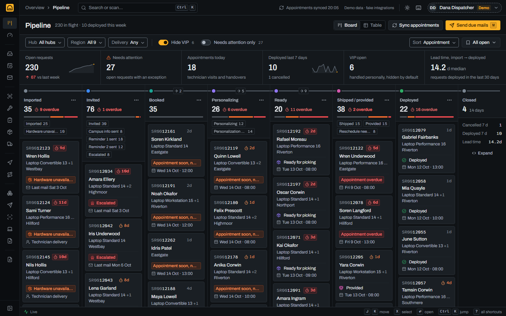

## About this project

Hangar is a clean-room re-engineering of an internal logistics tool, rebuilt from scratch as a
portfolio demo. All people, companies, sites and data are fictional: the operator is _Acme IT
Services_, its client _Globex Fleet AG_, the logistics partner _Initech Logistics_, and the hubs
are Riverton, Hillford and Eastgate. External integrations (the ticketing system, the booking
provider and the parcel carrier) are simulated by fake adapters, and every e-mail address uses
the reserved `example.com` domain.

## What it is

Every hardware replacement is a **service request** that travels down one line: Imported →
Invited → Booked → Personalizing → Ready → Shipped / provided → Deployed → Closed. Hangar shows
where every request sits on that line, what is stuck, and the one thing to do next: the
pipeline board, dense tables with saved views, a detail drawer with the request's own line and a
"next step" block, scan stations for the warehouse, and a phone-sized tour for technicians.

## Feature tour

### Pipeline

Seven stage columns plus a collapsed Closed column, each with its count, an aging bar
(on time / aging / overdue) and the 24-hour flow between stages. Cards show the exception that
needs attention. A KPI strip on top; filters for hub, region, delivery type and VIP; saved views
in the URL. Cards never move by drag and drop: stage changes send mails and move devices, so
they happen through explicit actions.

### Requests and communications

|                                                                                               |                                                           |
| --------------------------------------------------------------------------------------------- | --------------------------------------------------------- |
| 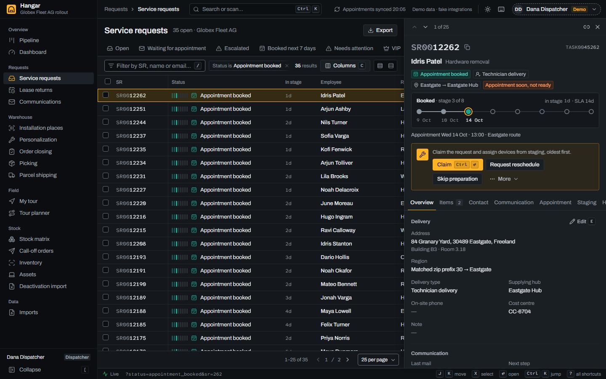 | 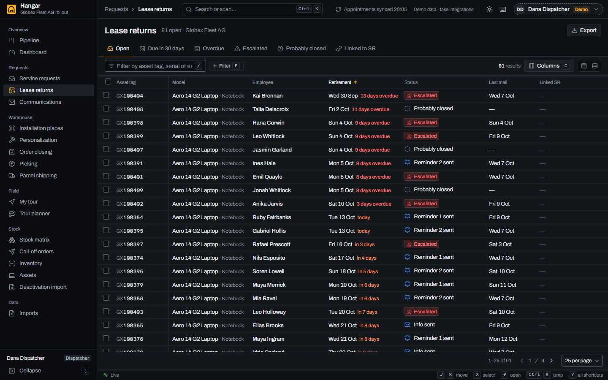 |

- **Service requests and lease returns**: virtualized tables with filter chips, saved views,
  column chooser, density modes, bulk actions and server-side paging, all in the URL.
- **Detail drawer**: docked next to the table (J/K move through records), with the request's
  line, the next step and its primary action, and tabs contributed by each module (items,
  contact, communication, appointment, staging, shipping, deployment, history).
- **Communications**: the daily mail chain (invitation, reminders, escalation) with a dry run,
  dispatch runs, a mail log with previews and the templates.

### Imports

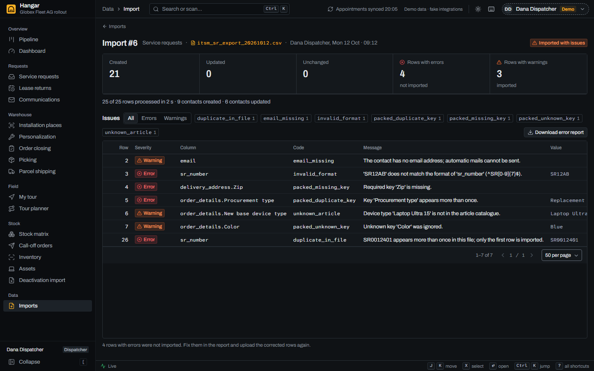

Drop a ticketing export (CSV or XLSX); the type is detected from the header row, the import runs
as a background job with live progress, and failed rows come back with the line, the field and
the reason, plus a CSV of just those rows.

### Warehouse and staging

|                                                               |                                                               |
| ------------------------------------------------------------- | ------------------------------------------------------------- |
| 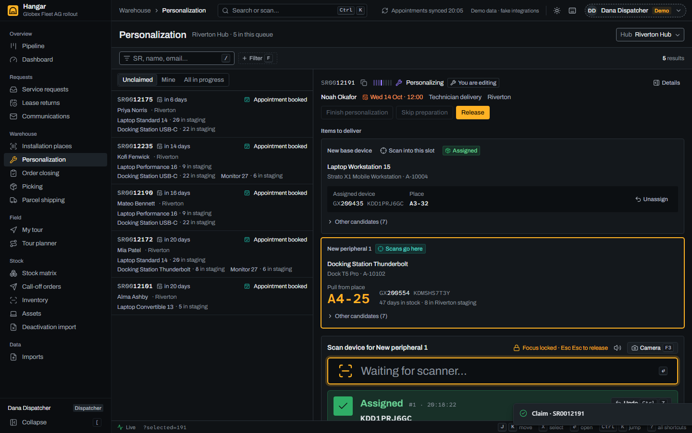 | 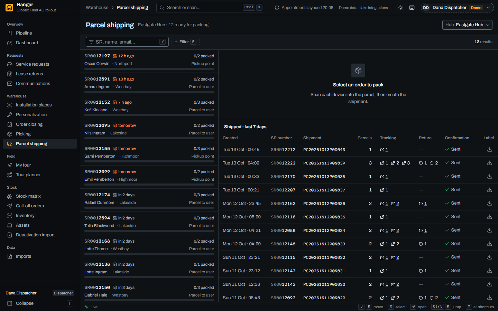 |

- **Personalization**: claim a request, assign devices by scanning (oldest stock first, with a
  warning for anything else), set installation places and the software checklist.
- **Order closing and picking** per hub and day.
- **Parcel shipping**: pack by scanning, then create the shipment with the carrier (label,
  tracking and return label).

### Field service and PWA

|                                                         |                                                                |                                                                                    |
| ------------------------------------------------------- | -------------------------------------------------------------- | ---------------------------------------------------------------------------------- |
| 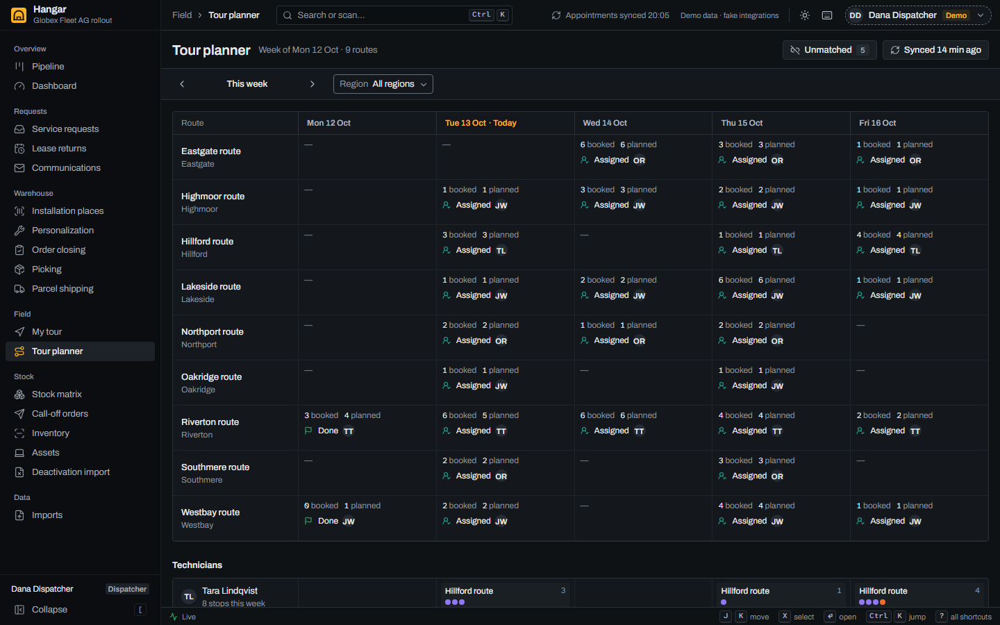 | 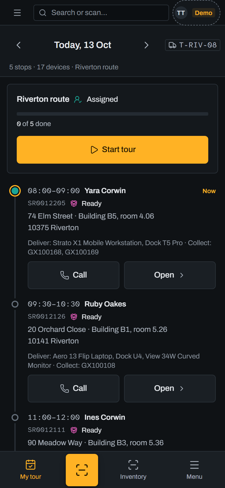 | 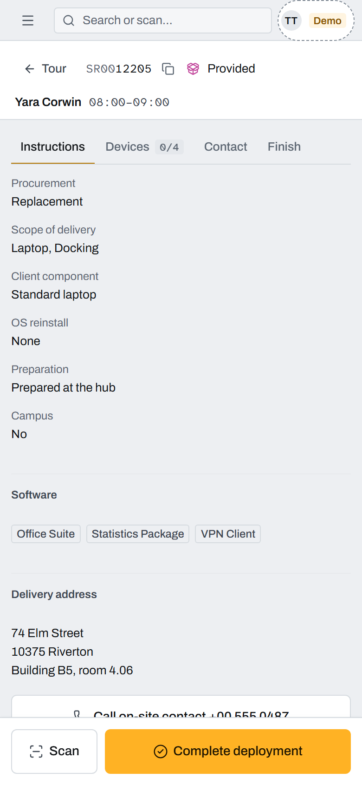 |

- **Tour planner**: the week by technician, unassigned stops, capacity, conflicts.
- **My tour** for technicians: today's stops on a vertical line, one-thumb actions, 48 px
  targets, installable as a PWA and usable offline once loaded.
- **Deployment**: scan the new and the old devices with a wedge scanner or the phone camera,
  record deviations, complete, and send the protocol.

### Stock and inventory

|                                                         |                                                                     |
| ------------------------------------------------------- | ------------------------------------------------------------------- |
| 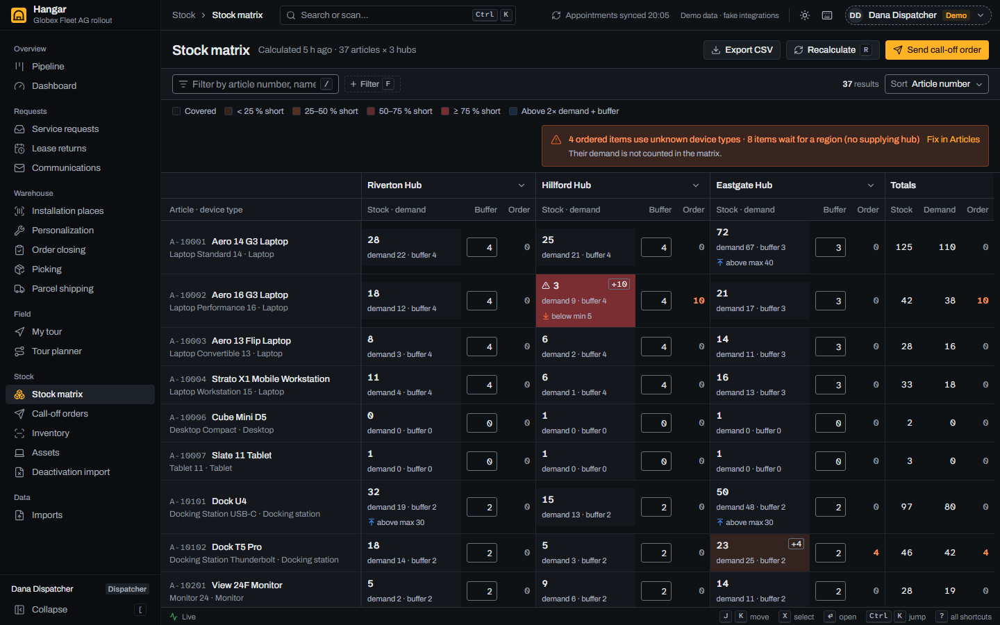 | 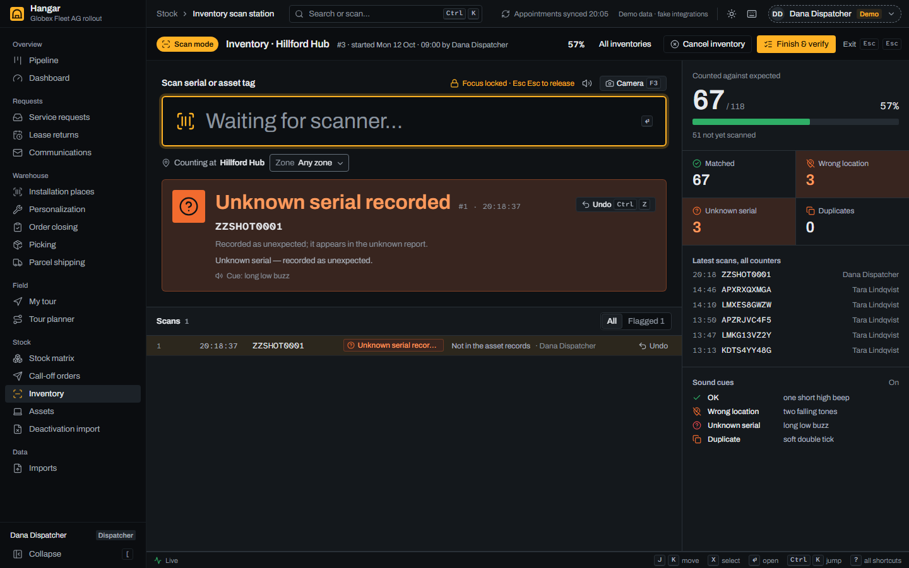 |

- **Stock matrix**: articles × hubs with a shortage heat ramp, demand and buffer per cell, and
  call-off orders to the logistics partner.
- **Inventory**: a focus-locked scan station (one verdict per scan: OK, wrong location, unknown
  serial, duplicate), live reconciliation, and a missing-device report when it closes.
- **Assets** with their movement ledger, and a deactivation import.

### Dashboard and the command palette

|                                                   |                                                               |
| ------------------------------------------------- | ------------------------------------------------------------- |
| 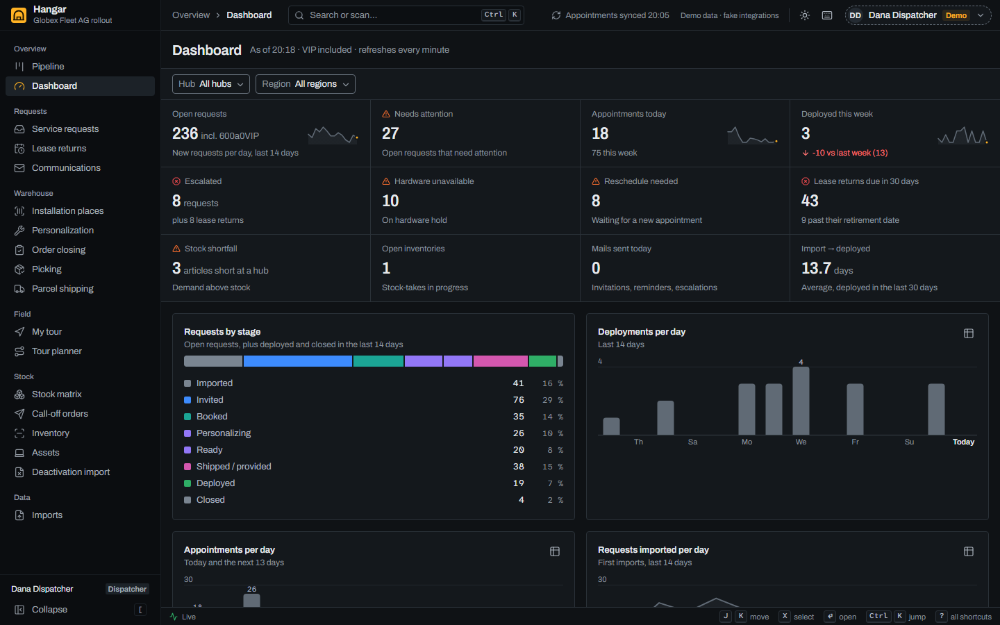 | 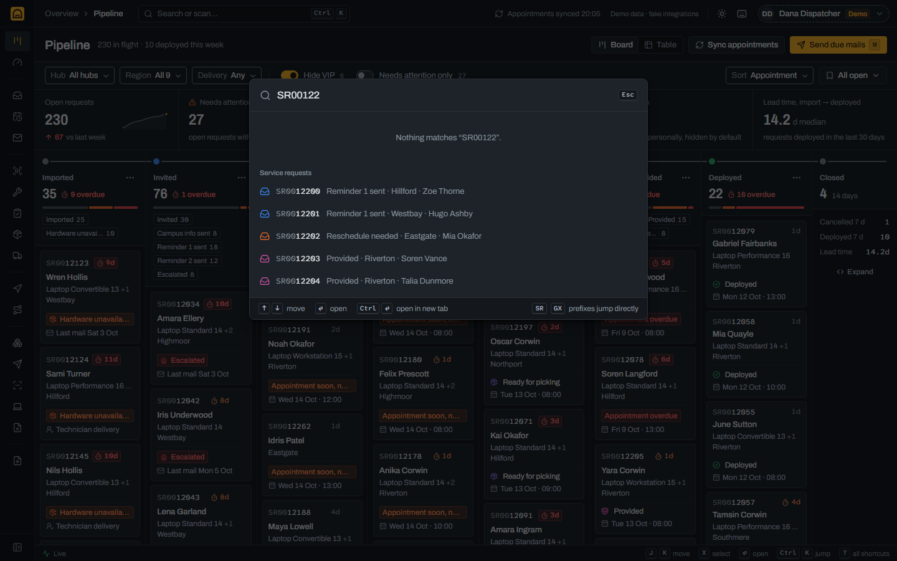 |

KPIs with sparklines and charts that switch to a table view. ⌘K jumps straight to a record from
an SR number, asset tag or serial (a barcode scan works too), navigates, and runs commands.

More screens: [login](docs/screenshots/login-dark.png),
[pipeline (light)](docs/screenshots/pipeline-light.png),
[drawer (light)](docs/screenshots/service-requests-drawer-light.png),
[my tour (light)](docs/screenshots/my-tour-phone-light.png),
[deployment (dark)](docs/screenshots/deployment-phone-dark.png).

## Why this stack

| Choice                                             | What it does for this app                                                                                                                                                                                                                                                                         |
| -------------------------------------------------- | ------------------------------------------------------------------------------------------------------------------------------------------------------------------------------------------------------------------------------------------------------------------------------------------------- |
| **React 19 + TanStack Router**                     | Typed, validated URL search params: every filter, sort, page, saved view and open drawer (`?sr=223&tab=history`) lives in the URL, so a view is a link a dispatcher can share. File-based routes are split per screen automatically.                                                              |
| **TanStack Query**                                 | Server state with keep-previous-data (refetches dim the old rows instead of flashing skeletons), declarative invalidation on mutations, and job polling for imports and syncs.                                                                                                                    |
| **TanStack Table + Virtual**                       | Hundreds of rows with column visibility, order and sizing per user; only the visible rows are in the DOM, and the keyboard cursor (J/K) works across the virtual list.                                                                                                                            |
| **Radix UI + cmdk**                                | Accessible primitives (dialogs, menus, popovers, tabs, radio groups) styled with the design tokens, and the ⌘K palette.                                                                                                                                                                           |
| **Tailwind CSS v4**                                | The design tokens are the theme: only token utilities exist (the stock palette is disabled), both themes come from one `light-dark()` definition, and density is a `data-density` variant.                                                                                                        |
| **vite-plugin-pwa + BarcodeDetector / zxing-wasm** | Technicians install My tour on their phone; camera scanning uses the native `BarcodeDetector` with a self-hosted zxing-wasm fallback, and USB/Bluetooth wedge scanners work as keyboards.                                                                                                         |
| **MSW demo mode**                                  | The static demo runs the real UI against a mock API inside the service worker. Its database is the backend's own seed export (`seed.json`), stored incrementally in IndexedDB, and the mock follows the backend's transition maps, guards and permissions, so the demo behaves like the real API. |

## Design system

- **Graphite + signal amber.** A cool blue-grey console with one warm accent. Amber means
  "you / now / act": the primary action, keyboard focus, selection, the current stage, the live
  scan field. Statuses never use it; they have eight tone families with icon + label.
- **"The Line".** The pipeline drawn at three scales: column headers are stations on a rail, every
  status cell has a StageTrack (eight ticks), and the drawer shows the request's own line with
  dates.
- **Type.** Archivo (variable width) for UI and figures; Atkinson Hyperlegible Mono for SR
  numbers, asset tags and serials, with "significant-digit ink" (`SR00`**`12388`**).
- **Density modes.** Compact (32 px rows) and comfortable (40 px), toggled with `D`; touch
  devices get 44 px targets.
- **Dark and light** from the same tokens; the rail stays graphite in both. WCAG 2.1 AA
  contrast, visible focus everywhere, reduced motion respected.

## Architecture

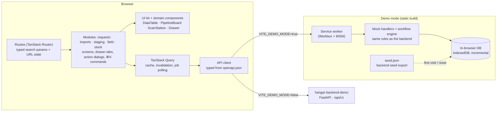

**Module registries.** Modules extend shared screens by creating files; shared code never imports
a module. `import.meta.glob` collects them:

| File in `src/modules/<module>/`                                              | Contributes                                             |
| ---------------------------------------------------------------------------- | ------------------------------------------------------- |
| `nav.ts`                                                                     | rail entries and `g` shortcuts                          |
| `sr-drawer-tabs/*.tsx`, `lease-drawer-tabs/*.tsx`, `asset-drawer-tabs/*.tsx` | drawer tabs (loaded lazily)                             |
| `action-dialogs/*.tsx`                                                       | dialogs for workflow actions in the drawer's action bar |
| `drawers/*.tsx`                                                              | drawers opened by a URL param (the mail preview)        |
| `commands.ts`                                                                | ⌘K commands                                             |
| `mocks/handlers.ts`, `mocks/workflow.ts`, `mocks/seed.ts`                    | the module's mock API, guards and effects, demo tables  |

## Keyboard shortcuts

`?` shows all shortcuts for the current screen; single-key shortcuts can be switched off there.

| Where         | Keys                                                                                                                                                                                                                                                                                                    |
| ------------- | ------------------------------------------------------------------------------------------------------------------------------------------------------------------------------------------------------------------------------------------------------------------------------------------------------- |
| Everywhere    | `⌘K` / `Ctrl K` palette · `?` shortcuts · `T` theme · `D` density · `[` collapse the rail                                                                                                                                                                                                               |
| Go to         | `g p` pipeline · `g s` service requests · `g l` lease returns · `g c` communications · `g w` personalization · `g o` order closing · `g k` picking · `g h` parcel shipping · `g t` tour planner · `g m` my tour · `g d` dashboard · `g x` stock matrix · `g r` inventory · `g a` assets · `g i` imports |
| Lists         | `J` / `K` or `↓` / `↑` move · `X` select · `Shift X` select page · `Enter` open · `Esc` clear · `/` search · `F` add filter · `C` columns · `[` / `]` page                                                                                                                                              |
| Drawer        | `J` / `K` next / previous record · `1`–`9` tabs · `⌘⏎` run the primary action · `Esc` close                                                                                                                                                                                                             |
| Pipeline      | arrow keys move between cards · `Enter` open · `M` send due mails                                                                                                                                                                                                                                       |
| Scan stations | `Enter` submit · `⌘Z` undo the last scan · `F2` sound · `F3` camera · `Esc Esc` release the focus lock                                                                                                                                                                                                  |

## Personas

All personas use the demo-only password `demo1234`; on the login screen, the persona cards (keys
`1`–`4`) sign in directly.

| Persona             | Role       | What to try                                                                                                   |
| ------------------- | ---------- | ------------------------------------------------------------------------------------------------------------- |
| **Dana Dispatcher** | dispatcher | the pipeline, sending due mails, imports, personalization, parcel shipping, the tour planner, call-off orders |
| **Theo Technician** | technician | My tour on a phone (or a narrow window): start the tour, scan devices, complete a deployment                  |
| **Vic Viewer**      | viewer     | the client's read-only view: everything visible, no action buttons                                            |
| **Ada Admin**       | admin      | master data (articles, regions, VIP list, users, calendars) and "Reset demo data"                             |

## Quick start

Requires Node 22.12+ (24 recommended, see `.nvmrc`) and pnpm 10.

```sh
pnpm install
pnpm dev:demo     # http://localhost:5173, runs fully in the browser (no backend)
```

Against the backend: start [hangar-backend-demo](https://github.com/martenackermann/hangar-backend-demo)
(`docker compose up --build` gives you the API, worker, PostgreSQL and Mailpit), then

```sh
cp .env.example .env.local   # VITE_API_URL=http://localhost:8100/api/v1
pnpm dev                     # http://localhost:5173 against the real API
```

| Command                          | What it does                                               |
| -------------------------------- | ---------------------------------------------------------- |
| `pnpm dev:demo` / `pnpm dev`     | dev server in demo mode / against the API                  |
| `pnpm build:demo` / `pnpm build` | production build (the demo build is what Vercel serves)    |
| `pnpm lint` · `pnpm typecheck`   | ESLint + Prettier · TypeScript                             |
| `pnpm test`                      | unit and component tests (Vitest)                          |
| `pnpm test:e2e`                  | end-to-end tests (Playwright)                              |
| `pnpm screenshots`               | regenerate `docs/screenshots/`                             |
| `pnpm api:types`                 | regenerate the API types from the backend's `openapi.json` |
| `pnpm seed:import`               | refresh `seed.json` from the backend's seed export         |

## Testing

- **Unit and component tests** (Vitest, jsdom): the UI kit, the data table's keyboard model,
  the workflow engine and transition maps, the mock handlers, the demo database's persistence,
  forms and screens. They run against the same MSW handlers as the demo.
- **End-to-end** (Playwright, Chromium): one spec per main flow and persona, from claiming and
  personalizing a request to completing a deployment on a phone. Every test fails on a console
  error. By default they run in demo mode against `pnpm dev:demo` with 2 workers.
- **Static build**: `pnpm build:demo`, serve `dist`, then `E2E_BASE_URL=http://localhost:4173 pnpm test:e2e`.
- **Against the real API**: start the backend and worker on a freshly seeded database, run
  `pnpm dev`, then
  `E2E_BASE_URL=http://localhost:5173 E2E_API_URL=http://localhost:8100/api/v1 pnpm test:e2e e2e/integration-flows.spec.ts`.

CI runs lint, typecheck, unit tests, the demo build and the e2e suite.

## Project structure

```
src/
  routes/              file-based routes (one per screen), _app = authenticated shell
  modules/             requests · imports · staging · field · stock (screens, tabs, dialogs, mocks)
  components/
    ui/                kit: buttons, inputs, select, combobox, date picker, dialogs, toasts…
    data-table/        DataTable, FilterBar, saved views, column chooser, bulk bar
    drawer/            drawer frame, SR / lease / asset drawers, workflow action bar
    scan/              ScanStation, ScanInput, verdict banner, scan list, camera
    domain/            StatusBadge, StageTrack, PipelineBoard, StatTile, StockHeatCell…
    app/               shell: rail, top bar, ⌘K, shortcut help, persona switcher
  lib/                 API client and types, auth, enums, formatting, URL search codec,
                       shortcuts, preferences, module registries
  mocks/               demo mode: in-browser database, workflow engine, core handlers, seed.json
  styles/              design tokens and the Tailwind theme
e2e/                   Playwright specs
docs/screenshots/      README screenshots
```

[CONVENTIONS.md](CONVENTIONS.md) is the contributor guide: how modules are built, the URL state
rules, the mock API and the testing setup.

## License

[MIT](LICENSE) © Marten Ackermann
